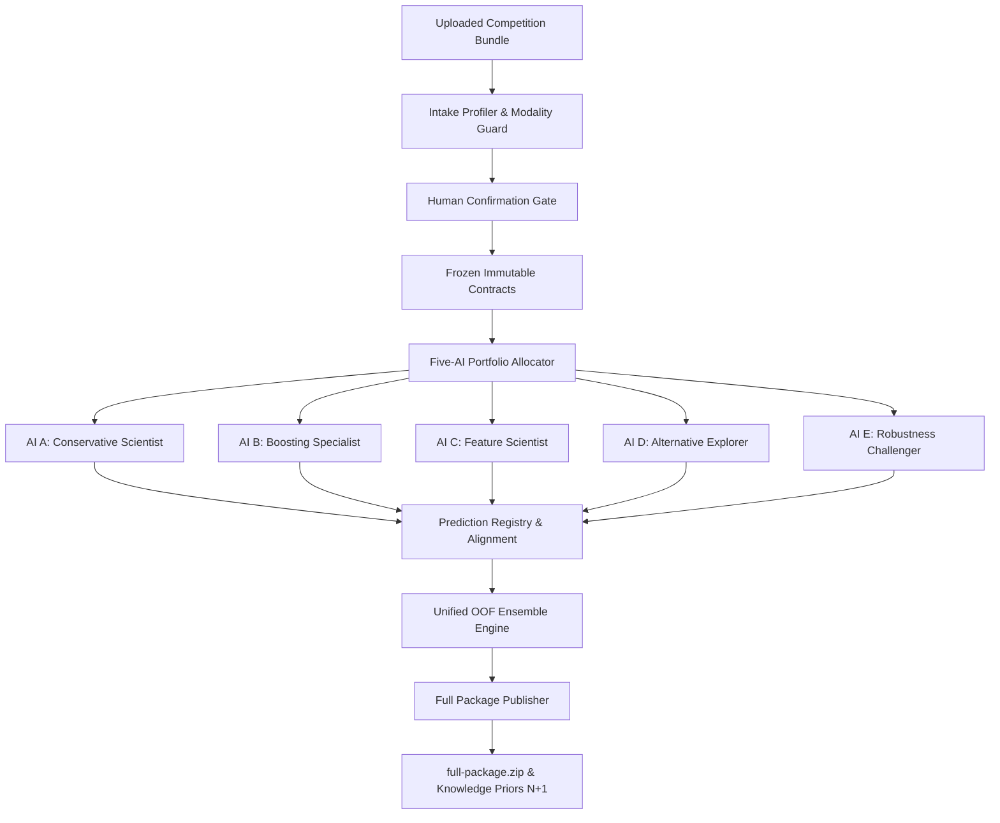
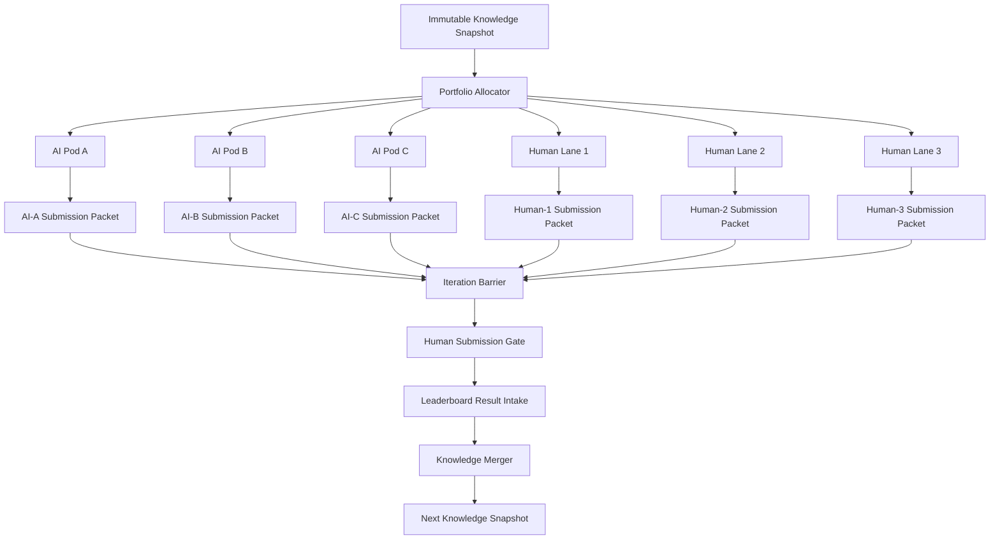
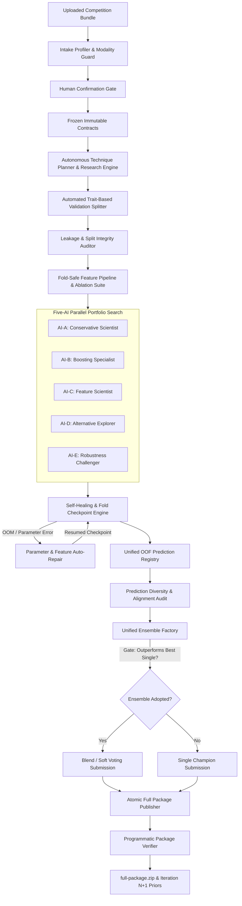

# SwarmFold Project Specification

## Document Status

| Field | Value |
|---|---|
| Project | SwarmFold |
| Stage | Five-AI portfolio implementation |
| Primary use | Local-first and distributed data science competitions |
| Team topology | One human control plane with optional distributed workers |
| AI topology | Five behavior-specific modeling lanes, individually enabled |
| Human topology | Confirmation and submission gates, not mandatory modeling lanes |
| Iteration output | One full package containing every enabled AI lane |
| Orchestration target | LangGraph with LangChain agents |

This document defines the intended system. A component described here must not be presented as implemented until code, tests, and runtime evidence exist in the repository.

### Current implementation status

| Surface | Status |
|---|---|
| Project concept and architecture | Documented |
| Operational contracts and invariants | Specified in prose |
| Machine-readable schemas | Initial Day 1 experiment schemas implemented |
| Python package and CLI | Initial LangGraph demo implemented |
| Coordinator and pod runtime | Phase 5 first-release implementation complete |
| Tests and fixture competition | Five-AI portfolio plus legacy coordinator tests implemented |
| MLflow and PostgreSQL deployment | Shared Compose deployment configured; live Docker runtime verification pending |
| Human and knowledge workflow | Confirmation, submission gate, prior-package memory, and snapshots implemented |
| Operational hardening | Access audit, resource accounting, migration, retention, DR verification, and effectiveness reports implemented |
| Competition integration | Human-controlled result intake implemented; direct competition upload intentionally excluded |

## Purpose

SwarmFold coordinates parallel AI and human experimentation for data science competitions. The primary topology is a five-AI local portfolio operating under one human control plane on a single machine, with an authenticated three-AI plus three-human distributed coordinator retained as a compatibility mode. Every enabled lane attempts the full competition pipeline under an immutable validation contract. At the end of an iteration, every lane publishes one verified terminal packet: a candidate, failure, or waiver. The ensemble engine and knowledge merger reconcile results, evaluate ensembling against the best single model, and produce an atomic full-package zip and reusable priors for the next iteration.

The objective is to improve leaderboard performance through search diversity, reproducible experiments, explicit validation, and cumulative knowledge. Agent count is not treated as a quality measure. A result becomes trusted only when deterministic execution and recorded artifacts support it. The local dashboard defaults to the five-AI portfolio; the distributed coordinator retains the earlier six-lane topology as a compatibility mode.

The local dashboard uses five AI modeling lanes and one human control plane as its default topology. AI A through AI E have distinct model-search charters and can be enabled individually. Bundle profiling and human confirmation happen once, enabled lanes share the same validation contract, and one start action fans out the portfolio. The earlier three-AI plus three-human coordinator topology remains accepted for compatibility with distributed deployments and existing evidence snapshots.

## Objectives

1. Run five specialized AI modeling lanes (Conservative, Boosting, Feature, Alternative, Robustness) under one human control plane on a single machine.
2. Provide distributed compatibility mode supporting three autonomous AI pods across separate laptops with three independent human lanes.
3. Produce valid submission candidates per iteration, subject to competition rules and quota.
4. Compare all candidates under one immutable validation contract.
5. Prevent duplicate experiments across laptops and iterations.
6. Record successful, failed, conflicting, and unverified findings.
7. Require executable evidence for model, metric, data, and API claims.
8. Explore model families appropriate to the problem instead of stopping at common gradient-boosted trees.
9. Preserve prediction diversity for later blending and stacking.
10. Convert each completed iteration into a versioned knowledge snapshot and atomic full-package archive.

## Non-Objectives

- SwarmFold does not guarantee a winning leaderboard score.
- SwarmFold does not treat public leaderboard movement as proof of generalization.
- SwarmFold does not bypass submission limits, team rules, data licenses, or external-data restrictions.
- SwarmFold does not give every agent unrestricted shell, credential, or submission access.
- SwarmFold does not merge all generated code into one permanent codebase.
- SwarmFold does not retain raw agent conversations as trusted knowledge.
- SwarmFold does not force every possible model family into every problem.

## Terminology

| Term | Definition |
|---|---|
| Iteration | One complete parallel search cycle ending after all required lane packets are available or explicitly waived |
| Lane | One independent AI or human path that produces one candidate and its evidence |
| Pod | One laptop-local AI swarm that completes the pipeline end-to-end |
| Charter | A bounded search mandate assigned to a lane for one iteration |
| Experiment | One executable hypothesis tested under a recorded data and validation context |
| Run | One concrete execution of an experiment configuration |
| Submission packet | Candidate predictions plus the evidence and artifacts needed to assess them |
| Knowledge snapshot | Immutable shared state consumed at the start of an iteration |
| Champion | Best currently accepted candidate under the declared selection policy |
| Challenger | Candidate intended to test a different mechanism or risk profile |
| OOF | Out-of-fold predictions aligned to the frozen training rows |

## System Principles

### End-to-end pod independence

Every laptop can inspect data, validate splits, construct features, train models, analyze errors, form ensembles, and attempt a submission candidate. Laptops are not permanently divided into data, modeling, and ensemble machines. A failed attempt still completes its lane by publishing verified failure evidence.

### Common truth, different search

All lanes receive the same competition rules, dataset fingerprint, metric implementation, validation split, baseline contract, and knowledge snapshot. Each lane receives a different charter to avoid converging immediately on the same solution. The validation contract is immutable within one iteration. A policy change creates a new version effective in a later iteration, and results from different versions cannot be compared as if they shared one evaluation context.

### Evidence before promotion

An agent statement is a proposal until it is linked to a real run, metric, artifact, or inspected source. Confidence language does not replace evidence.

### Local validation before leaderboard

Local validation drives routine experiment selection. Public leaderboard results are recorded as a separate evidence class. A leaderboard-only gain remains risky until additional evidence supports it.

### Structured communication

Agents exchange validated objects rather than free-form summaries. Large models, datasets, predictions, plots, and logs stay in artifact storage. Graph state contains identifiers, hashes, decisions, and compact findings.

### Human control of consequential actions

Humans approve competition submissions, changes to validation policy, external data, expensive budget increases, credential use, and any action affected by competition rules.

## High-Level Architecture

### Primary Architecture: Five-AI Local Portfolio



### Distributed Compatibility Mode (Three Laptops + Three Humans)

For teams deploying across multiple distributed physical machines, SwarmFold retains its authenticated multi-agent coordinator topology:



## Physical Deployment

### Coordinator services

One team-selected machine hosts the shared control services when running in distributed compatibility mode. Hosting does not change that machine's AI pod into a partial pipeline. Coordinator services receive reserved CPU, memory, storage, and network capacity so local training cannot starve shared state. The services may later move to another machine without changing pod semantics.

Planned services:

- PostgreSQL for coordinator records and durable graph checkpoints.
- MLflow Tracking Server for experiment metadata and artifact references.
- Coordinator API for iteration, lane, barrier, and knowledge operations.
- Shared artifact storage for models, predictions, plots, and logs.
- Knowledge merger process.

### Laptop-local services

Each laptop runs:

- One LangGraph pod process.
- One isolated experiment execution queue.
- Local dataset copy with verified hashes.
- Git checkout and per-experiment worktrees.
- MLflow client.
- Resource monitor for CPU, memory, storage, and optional GPU.

### Connectivity

The distributed laptops need authenticated network access to the coordinator API and MLflow server. If connectivity is interrupted, the local graph should retain its checkpoint and publish completed records after reconnection. Credentials must remain outside prompts, logs, source control, and knowledge packets.

## Portfolio Topologies

### Primary Topology: Five-AI Local Portfolio

The primary local iteration contains five AI modeling lanes under a single human control plane:

| Lane | Charter | Specialization & Focus |
|---|---|---|
| AI-A | Conservative Scientist | Stable linear and tree baselines, sanity checks, low-variance models |
| AI-B | Boosting Specialist | Regularized tree ensembles (HistGBM, LightGBM, XGBoost, CatBoost), bounded HPO |
| AI-C | Feature Scientist | Feature engineering, interactions, frequency/target encodings, TF-IDF representations, ablation studies |
| AI-D | Alternative Explorer | Prediction diversity, Extra Trees, alternative geometric/distance-based models |
| AI-E | Robustness Challenger | Seed stability, perturbation stress tests, intra-lane bagging/stacking |

### Distributed Compatibility Mode: Six-Lane Pods

For distributed multi-machine deployments, SwarmFold maintains the legacy six-lane topology:

| Lane | Default charter |
|---|---|
| AI-A | Stable local-validation champion |
| AI-B | Alternative features and model mechanisms |
| AI-C | Diversity, aggressive hypotheses, and ensemble candidates |
| Human-1 | Domain interpretation and manual data decisions |
| Human-2 | Independent feature and model design |
| Human-3 | Challenger, ablation, or manual blend |

These are defaults. In distributed mode, the Portfolio Allocator may rotate charters after reading the latest knowledge snapshot. It must record why each charter was assigned and how it differs from the other lanes. Before launch, the allocator compares each charter's target mechanism, feature family, model family, risk level, and expected prediction diversity. Duplicate charters are merged or reassigned unless a deliberate replication has been recorded.

Lanes remain isolated during the active search period. They may share frozen contracts and baseline utilities, but they do not consume another lane's unfinished conclusions. Synchronization happens at the iteration barrier.

## AI Pod Agent Design

Each laptop runs eighteen logical agent roles. Logical roles do not imply eighteen simultaneous model calls or eighteen concurrent training jobs.

| Agent | Responsibility | Required output |
|---|---|---|
| Pod Supervisor | Controls routing, budget, retries, and stopping | Pod state and final decision |
| Rules Agent | Extracts allowed data, metric, quota, and restrictions | Competition contract findings |
| Problem Formulation Agent | Infers task type, prediction structure, and the validation design required by deployment | Problem formulation report and adapter readiness |
| Data Contract Agent | Verifies schema, grain, IDs, target, and hashes | Data contract findings |
| Validation Agent | Audits splits, folds, metric, and leakage | Validation findings |
| Temporal Validation and Leakage Auditor | Tests deployment-split alignment, duplicate risks, and fold-local preprocessing requirements | Pass, warning, or blocked validation evidence |
| EDA Agent | Finds anomalies, cohorts, missingness, and structure | Evidence-backed hypotheses |
| Domain Target Decomposition Agent | Detects count, amount, exposure, hierarchy, and coherence opportunities without assuming them from names alone | Decomposition candidates requiring domain confirmation |
| Literature Research Agent | Searches scholarly indexes for data-handling methods related to the observed schema and competition domain | Cited methods, limitations, and testable handling recommendations |
| Model Scout | Maps problem structure to candidate model families | Model coverage matrix |
| Portfolio Planner | Deduplicates and ranks experiments | Bounded experiment queue |
| Feature Engineer | Implements approved feature hypotheses | Tested feature changes |
| Model Engineer | Implements approved model configurations | Tested model changes |
| Experiment Runner | Executes deterministic training functions | MLflow runs and artifacts |
| Result Critic | Challenges metrics, stability, and interpretation | Critique and next hypotheses |
| OOF Ensemble Scientist | Measures prediction diversity, evaluates voting, bagging, stacking, and OOF-weighted blends, then reports ensemble gain honestly | Ensemble eligibility, similarity, weights, gain, and decision |
| Robustness and Uncertainty Agent | Quantifies sampling uncertainty and records missing fold or seed stability evidence | Confidence interval and explicit limitations |
| Evidence Verifier | Verifies claims against code and artifacts | Accept, reject, or unverified verdict |

The Submission Auditor is a deterministic supervisor phase using the Validation Agent and Evidence Verifier outputs. It is not an additional unconstrained agent.

## Pod Execution Graph



## Experiment Lifecycle

Every experiment passes through these states:

```text
PROPOSED
-> DEDUPLICATED
-> PREFLIGHT_VALIDATED
-> QUEUED
-> RUNNING
-> SUCCEEDED or FAILED
-> EVIDENCE_VERIFIED
-> ACCEPTED, REJECTED, or UNRESOLVED
```

### Proposal requirements

An experiment proposal must include:

- Hypothesis.
- Mechanism expected to change the metric.
- Model family or feature family.
- Parent experiment or baseline.
- Frozen data version, split ID, and metric version.
- Estimated runtime and resource requirements.
- Expected observable signal.
- Falsification test.
- Risks, including leakage and competition-rule risks.
- Required dependencies.

### Preflight requirements

Before expensive training:

1. Confirm referenced columns and files exist.
2. Confirm imports, classes, functions, and parameter names exist.
3. Confirm dependency use is permitted and reproducible.
4. Run syntax, unit, and import checks.
5. Run a bounded smoke test on representative training-only data.
6. Confirm the validation and metric contract remains unchanged.
7. Confirm output paths and experiment IDs are unique.
8. Reject fabricated APIs, missing artifacts, and unexplained placeholders.

### Execution requirements

The Experiment Runner receives a validated configuration and calls deterministic training functions. It records parameters, metrics, timestamps, code version, data version, split ID, seed, runtime, failures, and artifact locations.

Agent reasoning may run concurrently. Full model training is scheduled according to actual laptop resources. A single-GPU laptop normally runs one GPU training job at a time.

### Stop conditions

A pod stops when one or more conditions apply:

- Declared runtime, run count, API, or compute budget is exhausted.
- No credible high-information experiment remains.
- Recent experiments repeatedly fail to improve or explain an uncertainty.
- The selected candidate satisfies the agreed threshold.
- Validation integrity becomes uncertain and requires human resolution.
- Competition rules or resource constraints block further work.

## Hallucination Control

### Planner-executor separation

LLM agents propose configurations and code changes. Deterministic tools execute training, metrics, artifact checks, and submission validation. An agent cannot promote its own claim merely by repeating it confidently.

### Structured outputs

Every agent returns a schema-validated response. Missing required fields, unknown enums, malformed identifiers, and invalid references cause rejection or bounded retry.

### Evidence references

Every material claim includes at least one source reference:

- Experiment run ID.
- Artifact URI and hash.
- Source file and code version.
- Data profile record.
- Saved metric output.
- Official documentation URL when an external API claim is involved.

### Independent verification

The Evidence Verifier receives the proposal, diff, execution log, metric record, and artifact manifest. It may inspect the Model Engineer's conclusion only as an untrusted claim.

A finding cannot enter `VALIDATED` or `CROSS_LANE` state unless deterministic checks resolve every referenced run ID, verify artifact hashes, match code, data, metric, and split versions, confirm successful execution, and recalculate or independently verify the recorded metric. An experiment cannot enter `ACCEPTED` state unless its required run and artifact checks pass. LLM judgment may explain or challenge evidence, but it cannot bypass these checks. This reduces and rejects unsupported claims; it does not guarantee that a model will never generate them.

### Retry limits

Suggested defaults:

- Structured-output failure: two retries.
- Import or API failure: one focused repair.
- Ordinary training failure: one focused repair.
- Implausible metric: route to validation and leakage diagnosis.
- Repeated failure: preserve the failure and stop the branch.

### Credential isolation

Agents do not receive raw competition credentials. Submission upload uses a dedicated human-controlled process. Secrets are never placed in prompts, Git, MLflow parameters, logs, or knowledge files.

## Model Exploration Policy

### Problem fingerprint

Before selecting models, the Model Scout records:

- Task type and official objective.
- Row and feature scale.
- Numeric, categorical, text, image, graph, spatial, or temporal modalities.
- Cardinality and sparsity.
- Groups, repeated entities, and time dependencies.
- Class imbalance and target distribution.
- Missingness mechanisms.
- Runtime and memory constraints.
- Need for probability calibration, ranking, uncertainty, or constrained outputs.

### Coverage matrix

The Model Scout creates `model-coverage.json`. Every relevant model family receives one status:

- `PLANNED`
- `TESTED`
- `RULED_OUT`
- `DEFERRED`
- `PROHIBITED`

Each status needs a reason tied to the problem fingerprint.

XGBoost, LightGBM, and CatBoost count as one broad boosting family for coverage accounting. Their differences can justify separate experiments, but they do not demonstrate broad mechanism exploration by themselves.

Before large boosting tuning, each pod must test at least two applicable non-boosting mechanisms. A family may be ruled out only with evidence covering data compatibility, expected inductive bias, compute feasibility, dependency availability, and a verifier verdict. If fewer than two non-boosting mechanisms are applicable, a human records a waiver and its evidence. A sentence from the Model Scout alone cannot satisfy this gate.

### Candidate families

The applicable set depends on the problem. It may include:

- Linear, generalized linear, and generalized additive models.
- Bagging, random forests, and extremely randomized trees.
- Gradient boosting.
- Kernel and distance-based methods.
- Neural tabular models.
- Statistical time-series models.
- Sequence and transformer models.
- Text, image, graph, survival, ranking, count, spatial, or multimodal models.
- Domain-specific heuristics and hybrids.

The system does not require inappropriate models to be trained. A technical exclusion with evidence satisfies the coverage gate.

### Tuning gate

Large tuning begins only after:

- A valid end-to-end baseline exists.
- Multiple relevant mechanisms have been tested or ruled out.
- Split and metric behavior are understood.
- The candidate has a plausible improvement mechanism.
- The proposed budget is justified by earlier evidence.

### Ensemble gate

Stacking or blending begins only after:

- Compatible OOF predictions exist.
- Row identity and fold provenance are verified.
- Base predictions were created without leakage.
- Prediction correlation or residual complementarity has been measured.
- A simpler averaging baseline exists.
- Meta-model training is cross-fitted when required.

Three similar boosting models are not assumed to be diverse merely because their libraries differ.

## Human Lanes

Each person develops one independent candidate using the same frozen competition, data, metric, and validation contracts. Humans may use domain understanding, manual inspection, alternative code, or selective AI assistance.

Each human lane publishes the same versioned lane-packet union as an AI pod. Human work is not exempt from data hashes, split IDs, run records, OOF alignment, or submission validation when those artifacts apply.

Humans collectively own:

- Competition-rule interpretation.
- Domain assumptions.
- Validation policy changes.
- External-data approval.
- Compute-budget exceptions.
- Final upload decisions.
- Resolution of conflicting evidence.

## Lane Packet

Every lane publishes exactly one versioned packet atomically. A packet is a `CandidatePacket`, `FailurePacket`, or `WaiverPacket`. `Submission packet` is a convenient name for a candidate package; it does not mean that the candidate was uploaded.

### Candidate packet

```text
candidate-packet/
├── submission.csv
├── oof_predictions.parquet
├── test_predictions.parquet
├── experiment-ledger.jsonl
├── findings.jsonl
├── artifact-manifest.json
└── decision.md
```

The packet schema version, manifest hash, and publication timestamp are written last. Readers ignore a directory until that completion record exists. Large artifacts may be represented by authenticated URI and checksum rather than copied into the packet.

### Failure packet

```text
failure-packet/
├── experiment-ledger.jsonl
├── findings.jsonl
├── failure-manifest.json
└── decision.md
```

A failed lane does not fabricate prediction files. Its manifest records the terminal reason, completed runs, preserved artifacts, missing deliverables, and whether retry is useful.

### Waiver packet

```text
waiver-packet/
├── waiver-manifest.json
└── decision.md
```

A `WaiverPacket` records the human decision, reason, approver, timestamp, incomplete work if any, and whether preserved artifacts exist. A waived lane does not use a failure manifest.

### Submission file requirements

- Exact required columns.
- Exact row count.
- Unique and correctly ordered identifiers.
- No missing or invalid predictions.
- Valid ranges and types.
- Reproducible source run.
- Hash recorded in the artifact manifest.

### Artifact manifest requirements

The candidate manifest records:

- Iteration and lane IDs.
- Candidate and source run IDs.
- Git commit when code is versioned in that lane.
- Environment lock hash when a reproducible software environment was used.
- Data, metric, and split versions.
- Prediction hashes and model hashes when a serialized model exists.
- Local validation summary.
- Runtime and resource use.
- Artifact URIs.
- Verification verdicts.

Machine-readable schemas will define required and optional fields for AI candidate, human candidate, failure, and waiver packets. Human candidate packets still require data, split, metric, prediction, and result provenance even when no serialized model or dedicated Git commit exists. `decision.md` must state the candidate, failure, or waiver outcome, evidence used, limitations, and recommended next action.

## Iteration Barrier

The global coordinator tracks the configured lane states:

```text
PENDING -> RUNNING
PENDING or RUNNING -> PACKET_READY
PACKET_READY -> VERIFIED_CANDIDATE, VERIFIED_FAILURE, or VERIFIED_WAIVER
VERIFIED_CANDIDATE -> SUBMITTED or WITHHELD
```

Terminal states for the search barrier are `VERIFIED_CANDIDATE`, `VERIFIED_FAILURE`, and `VERIFIED_WAIVER`. Every state requires the matching packet to pass schema, identity, and manifest verification. The barrier has a declared deadline; after it expires, humans decide whether unfinished lanes publish a failure packet, receive an extension, or publish a waiver packet.

The lifecycle is:

1. Close active search at the declared deadline or when all lanes finish.
2. Publish candidate, failure, or waiver records atomically.
3. Verify every packet and close the search barrier.
4. Apply the Human Submission Gate.
5. Upload selected candidates when rules and quota permit.
6. Ingest leaderboard results until a declared cutoff. Withheld candidates keep a null leaderboard result.
7. Merge all local evidence plus any available leaderboard evidence.
8. Publish the immutable next knowledge snapshot.

Leaderboard intake never blocks knowledge indefinitely. If results are delayed, the merger publishes a local-evidence snapshot and may append a versioned leaderboard addendum later.

Producing six default candidates does not authorize six uploads. The Human Submission Gate verifies competition quota, team policy, candidate validity, and whether each upload adds useful information.

## Knowledge Model

### Finding statuses

| Status | Meaning |
|---|---|
| `HYPOTHESIS` | Proposed but not tested |
| `OBSERVED` | Seen in at least one recorded context |
| `VALIDATED` | Supported under the declared validation policy |
| `CROSS_LANE` | Independently supported by multiple lanes |
| `LEADERBOARD_ONLY` | Public score moved without sufficient local support |
| `REJECTED` | Tested and unsupported or invalid |
| `CONFLICT` | Credible evidence disagrees |
| `UNKNOWN` | Evidence remains insufficient |

### Finding schema

```json
{
  "finding_id": "I004-AI-B-F012",
  "iteration_id": "I004",
  "source_lane": "AI-B",
  "status": "VALIDATED",
  "claim": "Frequency encoding improves rare-category handling",
  "mechanism": "Stable count information reduces sparse category fragmentation",
  "source_runs": ["I004-AI-B-E009"],
  "data_version": "sha256:replace-with-real-hash",
  "split_id": "group-cv-v1",
  "metric_name": "competition-metric",
  "local_delta": 0.0,
  "leaderboard_delta": null,
  "limitations": [],
  "artifact_uris": []
}
```

Numbers in examples are placeholders and must never be copied into actual evidence records without a real run.

### Knowledge snapshot

```text
knowledge/v004/
├── competition-contract.json
├── data-contract.json
├── validation-contract.json
├── champion-board.json
├── experiment-history.jsonl
├── accepted-findings.jsonl
├── rejected-findings.jsonl
├── conflicts.jsonl
├── prediction-diversity.json
├── hypothesis-backlog.json
├── lane-performance.json
└── iteration-summary.md
```

### Merge rules

1. Verify each packet before reading its conclusions.
2. Normalize results by data version, split, metric, and population.
3. Keep local and leaderboard evidence separate.
4. Deduplicate equivalent hypotheses and experiments.
5. Preserve rejected experiments and failure signatures.
6. Preserve conflicts rather than averaging them away.
7. Measure prediction diversity from aligned OOF or test predictions.
8. Promote only claims whose evidence supports the new status.
9. Build the next hypothesis backlog from unresolved high-value questions.
10. Publish an immutable next snapshot.

Raw chat history is excluded from trusted knowledge. It may remain in observability logs but must not be used as evidence unless converted into a verified finding.

## Suggested Iteration Program

The program is adaptive, but a ten-iteration competition may use this progression:

| Iteration | Primary focus |
|---|---|
| 0 | Contracts, metric reconstruction, dataset fingerprints, and baseline |
| 1 | Validation stress tests and leakage probes |
| 2 | Broad model-family coverage |
| 3 | First feature and representation families |
| 4 | Second feature and representation families |
| 5 | Targeted model-family development |
| 6 | Evidence-driven tuning |
| 7 | Error, cohort, and residual analysis |
| 8 | Diversity search and initial ensembles |
| 9 | Robustness, seeds, folds, and ablations |
| 10 | Final ensemble, submission selection, and reproducibility package |

Iteration focus can change when evidence shows that an earlier assumption is wrong.

## Shared State

The coordinator stores compact state similar to:

```text
competition_id
iteration_id
knowledge_version
competition_contract_version
data_version
metric_version
split_id
lane_charters
lane_statuses
experiment_budget
active_runs
candidate_registry
artifact_registry
submission_registry
barrier_status
human_decisions
```

Large dataframes, predictions, models, and logs are referenced by URI and hash rather than copied into graph state.

## Git and Isolation Strategy

Suggested branch namespaces:

```text
ai/laptop-a/iteration-004
ai/laptop-b/iteration-004
ai/laptop-c/iteration-004
human/member-1/iteration-004
human/member-2/iteration-004
human/member-3/iteration-004
```

Each experiment runs in a unique worktree or disposable checkout. Agents do not share writable source directories. Only reviewed utilities and accepted improvements move into the common baseline.

Generated data, model files, credentials, local databases, checkpoints, and large predictions remain outside Git. Manifests and small reproducibility metadata stay versioned.

## Experiment Tracking

Planned MLflow naming:

```text
Experiment: <competition-id>/<iteration-id>/<lane-id>
Run: <iteration-id>-<lane-id>-E<sequence>
```

Required tags:

```text
competition_id
iteration_id
lane_id
pod_id
charter_id
git_commit
data_version
metric_version
split_id
model_family
parent_run_id
```

Child runs may represent folds, seeds, or bounded tuning trials when that improves traceability.

## Failure Handling

| Failure | Response |
|---|---|
| Temporary API or network failure | Bounded retry with backoff |
| Invalid structured output | Schema feedback and bounded retry |
| Missing import or fabricated API | Reject or one focused repair |
| Training exception | Preserve logs and allow one focused repair |
| Implausible score | Pause search and run leakage diagnosis |
| Laptop interruption | Resume from durable local checkpoint |
| Coordinator unavailable | Continue safe local work and queue publication |
| Artifact upload failure | Retain local hash-addressed copy and retry publication |
| Conflicting results | Preserve both contexts and create a resolution experiment |
| Submission validation failure | Withhold upload and publish failure evidence |

Every retryable operation with external side effects must be idempotent. Re-running a node must not create duplicate experiment IDs, duplicate uploads, or conflicting ledger entries.

## Security and Competition Compliance

- Parse competition rules before the first experiment.
- Record allowed and prohibited data sources.
- Keep submission credentials human-controlled.
- Restrict agent tools by role.
- Treat notebooks, datasets, web pages, and generated files as untrusted content.
- Do not execute instructions embedded in data or downloaded artifacts.
- Redact credentials and sensitive values from logs.
- Validate paths before file operations.
- Record dependency sources and licenses when they affect competition eligibility.
- Respect team-level submission quota even when members have separate accounts.

## Skill Integration

The planned agent prompts may use the following skills from the companion skill repository:

| Skill | SwarmFold use |
|---|---|
| `my-ds-brain` | Pod supervision, state navigation, diagnostics, and human collaboration |
| `competition-score-lab` | Competition contract, validation, experiment loop, ensemble, and submission strategy |
| `coding-rules` | Repository-native code and evidence-based delivery |
| `data-exploration-lab` | Focused EDA, anomalies, cohorts, and hypotheses |
| `data-preparation` | Leakage-safe data transformation and split handoff |
| `iterate-modeling` | Bounded comparison of approved model and feature candidates |
| `code-review` | Review of generated implementation changes |
| `notebook-review` | Static audit and explicit clean-kernel reproduction |
| `ds-project-memory` | Multi-lane packet reconciliation, full package publisher, and knowledge snapshot production |
| `document-notebook` | Final notebook explanation and documentation |
| `human-writing` | Final report revision |
| `model-delivery` | Optional packaging when the selected model is used outside the competition |

One additional orchestration skill is expected: `competition-swarm-orchestrator`. It should own cross-laptop iteration state, lane charters, barrier semantics, submission packets, and knowledge fusion. It should not duplicate the modeling logic already owned by `competition-score-lab`.

## Planned Repository Layout

```text
swarmfold/
├── README.md
├── PROJECT_SPEC.md
├── pyproject.toml
├── compose.yaml
├── src/swarmfold/
│   ├── cli.py
│   ├── config.py
│   ├── schemas/
│   ├── contracts/
│   ├── coordinator/
│   ├── pods/
│   ├── agents/
│   ├── runners/
│   ├── verification/
│   ├── knowledge/
│   └── storage/
├── tests/
│   ├── unit/
│   ├── integration/
│   └── fixtures/
├── configs/
│   ├── example.competition.yaml
│   ├── example.pod-a.yaml
│   ├── example.pod-b.yaml
│   └── example.pod-c.yaml
├── prompts/
├── scripts/
└── docs/
```

This layout is a target, not authorization to create every directory before its implementation phase.

## Planned Command Interface

The following commands describe the intended interface. The team-MVP equivalents are implemented; competition-specific initialization and data verification remain future adapters:

```text
swarmfold init COMPETITION_PATH
swarmfold verify-data
swarmfold create-iteration --knowledge v003
swarmfold assign-charters
swarmfold run-pod --pod AI-A
swarmfold publish-human-packet --lane HUMAN-1 PACKET_PATH
swarmfold barrier-status
swarmfold validate-submissions
swarmfold record-leaderboard RESULTS_FILE
swarmfold merge-knowledge
swarmfold report-iteration
```

## Observability

Record:

- Graph and node execution IDs.
- Agent role and model configuration.
- Prompt and schema versions without secrets.
- Tool calls and normalized outcomes.
- Retry and timeout events.
- Experiment queue latency and runtime.
- Resource use by pod and run.
- Evidence-verification rejection reasons.
- Human approvals and edits.
- Knowledge promotion and conflict decisions.

Observability records explain system behavior but do not automatically become scientific evidence.

## Measuring Swarm Effectiveness

SwarmFold itself should be evaluated. Useful measures include:

- Valid experiments per compute hour.
- Duplicate experiment rate.
- Fabricated API rejection rate.
- Failed-run recovery rate.
- Share of experiments with reproducible artifacts.
- Number of model mechanisms tested or justified as excluded.
- OOF diversity among accepted candidates.
- Local-to-leaderboard rank consistency.
- Knowledge reuse rate across iterations.
- Repeated rejected-hypothesis rate.
- Human time spent resolving agent failures.
- Score improvement against the same compute budget without the swarm.

Agent count should be reduced when additional agents increase cost without improving these measures.

## Implementation Roadmap

The Phase 1 result is the developer MVP. The team MVP requires Phases 1 through 4 plus minimum authentication, credential isolation, role-scoped tools, idempotent publication, and backup. Phase 5 adds broader operational hardening.

### Five-AI dashboard portfolio delivery

| Phase | Delivered behavior | Exit evidence |
|---|---|---|
| 1. Portfolio contract | AI A through AI E configuration, enable toggles, per-lane budgets, total hard cap | Invalid, duplicate, empty, and oversized portfolios are rejected before training |
| 2. Shared intake gate | One bundle analysis, one editable profile, blocker resolution, separate confirmation and training actions | No lane starts before the confirmed shared contract is execution-ready |
| 3. Multi-lane runtime | Independent lane threads, output folders, statuses, and bounded parallel execution | Only enabled lanes execute and every result remains attributable to its lane |
| 4. Evidence aggregation | Mandatory cross-lane OOF ensemble and one complete ZIP with bundle, packets, ledger, findings, literature, notebook, submission, manifest, and knowledge Markdown | The final submission uses an aligned OOF-selected ensemble and records whether it improved over the strongest single model |
| 5. Control-room UI and hardening | Five configuration cards, live lane rail, one start action, one full-package download, Docker limits, and regression tests | UI and API expose one coherent portfolio session without separate artifact buttons |

The default dashboard target is five experiments per enabled lane, or 25 total. Five is
also the per-lane minimum so every lane can evaluate an ensemble candidate. The UI allows
up to 100 per lane, while the server limits the portfolio to 200 by default through
`SWARMFOLD_MAX_PORTFOLIO_EXPERIMENTS`. `SWARMFOLD_MAX_CONCURRENT_TRAINING` independently
caps simultaneous model fitting. Dashboard lanes have no elapsed-time cutoff. They continue
until the configured experiment target is exhausted or an unrecoverable experiment error
prevents the lane from producing further valid evidence.

### Phase 1: Single-laptop vertical slice

Implement one pod with:

- Competition, data, metric, and validation contracts.
- Structured experiment proposal.
- Deterministic runner.
- Evidence verifier.
- MLflow logging.
- Submission packet export.

Exit criteria:

- One small fixture competition runs end-to-end.
- An invalid API proposal is rejected before training.
- A valid experiment creates reproducible metrics and artifacts.
- A submission packet validates against its schema.

### Phase 2: Local multi-agent pod

Add:

- LangGraph routing and checkpointing.
- Nineteen logical roles, including experiment memory and shared evidence specialists.
- Experiment queue and budget enforcement.
- Result critic loop.
- Model coverage and ensemble gates.

Exit criteria:

- Interrupted execution resumes without duplicating completed runs.
- Duplicate hypotheses are detected.
- Training concurrency respects resource limits.
- A pod produces exactly one verified terminal lane packet and produces a candidate packet on success.

### Phase 3: Three-laptop coordination

Add:

- Minimum authentication, credential isolation, and role-scoped tools.
- Minimum coordinator and artifact backup with a tested restore path.
- Coordinator API.
- Shared PostgreSQL and MLflow deployment.
- Pod registration and health reporting.
- Lane charters.
- Artifact upload and hash verification.
- Iteration barrier.

Exit criteria:

- Three laptops consume the same immutable contracts.
- Each pod publishes an independently verifiable packet.
- Temporary network failure does not lose completed runs.

### Phase 4: Human lanes and knowledge loop

Add:

- Human packet publishing.
- Submission approval interface.
- Leaderboard result intake.
- Multi-lane knowledge merger and ensemble engine.
- Versioned knowledge snapshots and atomic full-package archive.

Exit criteria:

- Multi-lane AI and human packets can be reconciled.
- Failures and contradictions are preserved.
- The next iteration consumes the newly published snapshot.

### Phase 5: Hardening

Add:

- Expanded authentication policy and access auditing.
- Expanded backup retention and disaster recovery.
- Resource accounting.
- Integration and failure tests.
- Prompt and schema version migration.
- Swarm-effectiveness evaluation.

## Initial Acceptance Criteria

SwarmFold reaches a usable first release when:

1. Each of three laptops can independently produce one valid candidate packet.
2. Three human packets can be registered with the same schema.
3. No candidate can pass without data, split, metric, run, and artifact provenance.
4. The system rejects a deliberately fabricated model API.
5. The system detects a deliberately leaked validation transform.
6. Experiment IDs remain unique across laptops and retries.
7. A stopped pod resumes without repeating completed training.
8. Verified terminal lane packets trigger the post-barrier workflow; the knowledge merger runs after the declared leaderboard intake cutoff or immediately when no upload result is expected.
9. The merger preserves accepted, rejected, leaderboard-only, and conflicting evidence.
10. A new immutable knowledge snapshot can start the next iteration.

## Open Decisions

- Exact competition used for the first fixture.
- Operating systems and available CPU, memory, and GPU on each laptop.
- Whether the coordinator is LAN-only or accessible through a private overlay network.
- PostgreSQL and artifact-storage deployment method.
- Exact Gemini model configuration and budget per role.
- Whether a stronger model is available for supervision or verification.
- Maximum agent calls and experiment runs per iteration.
- Human interface for packet publication and submission approval.
- Policy for accepting external packages and data.
- Backup location and retention period.

## References

- [LangGraph overview](https://docs.langchain.com/oss/python/langgraph/overview)
- [LangChain subagents](https://docs.langchain.com/oss/python/langchain/multi-agent/subagents)
- [LangChain router](https://docs.langchain.com/oss/python/langchain/multi-agent/router)
- [LangGraph persistence](https://docs.langchain.com/oss/python/langgraph/persistence)
- [LangGraph human-in-the-loop](https://docs.langchain.com/oss/python/langchain/human-in-the-loop)
- [LangGraph fault tolerance](https://docs.langchain.com/oss/python/langgraph/fault-tolerance)
- [Gemini function calling](https://ai.google.dev/gemini-api/docs/function-calling)
- [Gemini structured output](https://ai.google.dev/gemini-api/docs/structured-output)
- [MLflow Tracking](https://mlflow.org/docs/latest/tracking)
