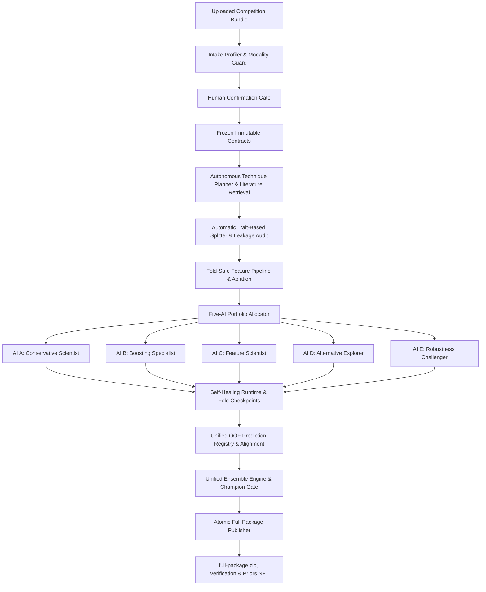
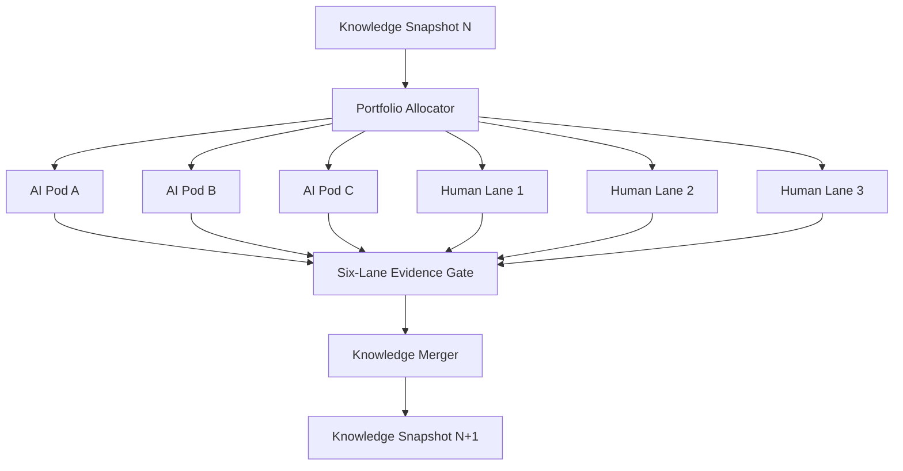

<div align="center">
  <h1>SwarmFold</h1>
  <p><strong>Distributed multi-agent experimentation for data science competitions</strong></p>

  <p align="center">
    
    
    
    
  </p>

  <p align="center">
    SwarmFold coordinates ten behavior-specific AI modeling lanes under one human control plane. Every iteration produces one complete evidence package and a reusable knowledge report for the next search cycle.
  </p>
</div>

## Current Status

SwarmFold operates on a production **five-AI local portfolio** topology under human control. The following capabilities are **operational** end-to-end through the default dashboard workflow:

- **Intake & Modality Guard**: Automatically profiles arbitrary competition bundles (Parquet, CSV, TSV) and blocks unsupported modalities (audio, video, raw images) before training.
- **Human Confirmation Gate**: Locks the immutable problem contract, target, metric, and validation strategy before compute begins.
- **Five Specialized AI Modeling Lanes**:
  - **AI A (Conservative Scientist)**: Stable linear and tree baselines, sanity checks, low-variance models.
  - **AI B (Boosting Specialist)**: Regularized tree ensembles (HistGBM, LightGBM, XGBoost, CatBoost) with adaptive HPO via `HPOController` — parameters are sampled from a persistent study and pruned by fold-level median performance.
  - **AI C (Feature Scientist)**: Feature engineering, TF-IDF text representations, and ablation studies.
  - **AI D (Alternative Explorer)**: Prediction diversity, extra trees, and alternative geometric models.
  - **AI E (Robustness Challenger)**: Seed stability, stress tests, and intra-lane bagging/stacking.
- **Adaptive Scheduling**: `AdaptiveScheduler` reorders the experiment queue after every completed trial, prioritising models with positive marginal contribution.
- **Technique Retrieval**: `TechniqueRetriever` performs role-scoped RAG from 468 canonical knowledge cards before each scouting call; results are mapped to a typed `TechniquePlan` with runtime registry references.
- **Self-Healing Execution**: Automatic error classification (OOM, invalid parameters, numerical instability, data shape), parameter/feature repair, fold-level checkpoint resumption. Provider and network failures receive bounded exponential backoff retries (max 3, 1 s → 2 s → 4 s) before an experiment is marked FAILED.
- **Unified OOF Ensemble Engine**: Caruana greedy selection, SLSQP constrained blending, cross-fitted stacking (binary, multiclass, multilabel, regression, and time-series forecasting), and weighted averaging. Champion Gate rejects any ensemble that does not strictly improve over the best validated single model.
- **Iteration Reflection**: `IterationReflector` generates per-iteration structured insights that are stored and forwarded as prior knowledge to the next run, enabling cross-iteration learning without reusing a champion blindly.
- **Atomic Full Package**: Every run publishes a self-contained `full-package.zip` with complete lineage, OOF predictions, ensemble reconstruction metadata, reproduction notebook, manifest hashes, and reusable priors for iteration N+1.

> **Multilabel classification** and **time-series forecasting** have typed adapters and ensemble support but are blocked at the dashboard confirmation gate pending complete end-to-end execution fixtures.

See the complete [Capability Matrix](docs/capability_matrix.md) for current component lifecycle states.

## Development Quickstart

```bash
uv sync --extra dev
uv run swarmfold run-demo
uv run pytest
```

### Installing Optional Boosting Libraries

XGBoost, CatBoost, and LightGBM are optional extras. Install them to unlock their candidates in lane AI-B:

```bash
# Install all boosting libraries at once
uv sync --extra boosting

# Or individually
uv sync --extra lightgbm   # LightGBM only
uv sync --extra xgboost    # XGBoost only
uv sync --extra catboost   # CatBoost only
```

Once installed, the `CandidateFactory` eligibility check (`installed=True, executable=True`) will automatically include them in AI-B's search.

The demo executes the local pod from contract inspection through portfolio search, result criticism, evidence verification, and atomic publication. Candidate packets include a fixture submission file plus the complete experiment ledger and findings; failure packets never fabricate a submission. Mock planning does not require an API key.


## Primary Architecture: Five-AI Local Portfolio



## Control Room Dashboard & Verification CLI

The coordinator serves a local-first experiment dashboard at `http://localhost:8000`.

### Capability Matrix and Package Verification Tools

```bash
# Display the capability matrix across all models, features, validation splitters, and tasks
uv run swarmfold capability-matrix

# Export the matrix in JSON format
uv run swarmfold capability-matrix --format json

# Programmatically verify integrity, relative paths, file presence, and secret absence
uv run swarmfold verify-package path/to/full-package.zip
```

### Full Package Contents

Every portfolio run publishes one `full-package.zip` containing:
1. `competition-bundle/`: Original competition files and Markdown brief.
2. `contracts.json` & `data-fingerprints.json`: Immutable task definitions and input data hashes.
3. `experiments/{lane_id}/`: Lane result packets, fold checkpoints, and experiment notebooks.
4. `experiment-ledger.jsonl` & `findings.jsonl`: Complete consolidated trial ledger.
5. `literature-review.json` & `technique-evidence.json`: Retrieved research and technique evidence.
6. `validation-audit.json`: Leakage and split consistency audit report.
7. `ensemble-assessment.json` & `ensemble_spec.json`: Correlation matrix, blend weights, and gate decision.
8. `end-to-end.ipynb` & `submission.csv`: Unexecuted reproduction notebook and final submission.
9. `experiment-knowledge.md`: Reusable lessons, hypothesis verdicts, and priors for iteration N+1.
10. `environment-lock.json` & `manifest.json`: Runtime versions and SHA-256 hashes for all files.

## Distributed Compatibility Mode (Three Laptops + Three Humans)

For teams deploying across multiple distributed physical machines, SwarmFold maintains an authenticated **Distributed Compatibility Mode**:



In this mode, three physical laptops run independent pods alongside three human participants. Each lane synchronizes via the coordinator API at the iteration barrier before knowledge merging.

## Design Priorities

- Each laptop attempts the entire competition workflow and publishes one verified terminal lane packet. Successful runs contain a candidate; failed or waived runs preserve their evidence without fabricating one.
- AI outputs are proposals until deterministic tools verify them.
- SwarmFold now features a 10-Lane Grandmaster architecture, adding 5 new autonomous nodes: Meta-Strategist, Diversity Miner, Deep Feature Synthesizer, Adversarial Auditor, and HPO Grandmaster.
- All lanes share the same data, metric, and validation contracts.
- Search charters keep the lanes meaningfully different.
- Local validation remains the primary selection evidence.
- Failed experiments remain searchable so later agents do not repeat them.
- Submission upload remains behind a human gate and competition-rule check.

## Documentation

- [Complete project specification](PROJECT_SPEC.md)
- [MIT License](LICENSE)

## Technology

The team MVP uses Python, FastAPI, SQLAlchemy, PostgreSQL, LangChain model integrations, LangGraph with laptop-local SQLite checkpoints, Pydantic schemas, scikit-learn, and shared MLflow. Packet archives contain relative, hash-addressed artifacts so the coordinator can verify them without access to the originating laptop.

Each pod also has a literature research agent between EDA and model scouting. When
`SWARMFOLD_LITERATURE_RESEARCH=true`, it searches OpenAlex and Crossref for journal
metadata related to the confirmed competition brief and feature schema. The resulting
`literature-review.json` is included in the terminal packet and generated notebook.
Literature is treated as hypothesis support only; local validation remains required before
any method is promoted. OpenAlex works without a key at its basic allowance, while
`OPENALEX_API_KEY` and `CROSSREF_MAILTO` enable the providers' preferred access modes.

## Three-laptop coordinator

Create `.env` from `.env.example` and replace every coordinator, pod, database, and provider placeholder with independently generated secrets. The coordinator expects one admin token and a JSON mapping containing exactly three pod tokens. Each laptop receives only its own value as `SWARMFOLD_POD_TOKEN`.

Start PostgreSQL, the coordinator API, and MLflow on the coordinator machine:

```bash
docker compose up -d postgres coordinator mlflow
```

Freeze the shared contracts and create the iteration:

```bash
uv run swarmfold freeze-contracts --output-dir .swarmfold/contract-source
uv run swarmfold create-iteration \
  --coordinator-url http://coordinator-host:8000 \
  --iteration-id iteration-1 \
  --contracts .swarmfold/contract-source/contracts/bundle.json \
  --charters config/lane-charters.example.json
```

On each laptop, register the pod and fetch the immutable iteration. Replace the pod and lane IDs with `pod-b`/`ai-b` or `pod-c`/`ai-c` as appropriate:

```bash
uv run swarmfold register-pod \
  --coordinator-url http://coordinator-host:8000 \
  --pod-id pod-a --iteration-id iteration-1 --lane-id ai-a
uv run swarmfold fetch-iteration \
  --coordinator-url http://coordinator-host:8000 \
  --iteration-id iteration-1
uv run swarmfold run-demo \
  --contracts-file .swarmfold/shared-iteration.json \
  --iteration-id iteration-1 --lane-id ai-a --thread-id iteration-1-pod-a \
  --tracking-uri http://coordinator-host:5000
```

Queue the resulting packet before attempting network publication. A failed upload remains in the outbox and can be retried safely:

```bash
uv run swarmfold queue-packet PATH_TO_PACKET \
  --iteration-id iteration-1 --lane-id ai-a
uv run swarmfold flush-outbox --coordinator-url http://coordinator-host:8000
```

## Human lanes and knowledge loop

Each human prepares a metadata JSON document plus the artifacts required by the selected packet type. Candidate packets require `submission.csv`, OOF predictions, test predictions, an experiment ledger, and findings. Failure packets require the ledger and findings. Waivers require only the metadata decision and frozen contracts.

```bash
uv run swarmfold publish-human-packet \
  --metadata human-1.json \
  --contracts .swarmfold/contract-source/contracts/bundle.json \
  --submission submission.csv \
  --oof-predictions oof_predictions.parquet \
  --test-predictions test_predictions.parquet \
  --experiment-ledger experiment-ledger.jsonl \
  --findings findings.jsonl
uv run swarmfold queue-packet PATH_TO_HUMAN_PACKET \
  --iteration-id iteration-1 --lane-id human-1 \
  --outbox-dir .swarmfold/human-outbox
uv run swarmfold flush-outbox \
  --coordinator-url http://coordinator-host:8000 \
  --outbox-dir .swarmfold/human-outbox --admin
```

After all six packets arrive, record one immutable decision for every candidate. `SUBMITTED` means a human performed the external upload; SwarmFold never receives the competition credential.

```bash
uv run swarmfold submission-gate \
  --coordinator-url http://coordinator-host:8000 --iteration-id iteration-1
uv run swarmfold decide-submission \
  --coordinator-url http://coordinator-host:8000 --iteration-id iteration-1 \
  --lane-id ai-a --decision SUBMITTED --approver team-owner \
  --reason "Best verified local candidate within quota"
uv run swarmfold record-leaderboard \
  --coordinator-url http://coordinator-host:8000 --iteration-id iteration-1 \
  --lane-id ai-a --score 0.81 --recorded-by team-owner
```

When no result is expected, close intake explicitly. Then merge all accepted, rejected, conflicting, and leaderboard-only evidence into the next version:

```bash
uv run swarmfold close-leaderboard \
  --coordinator-url http://coordinator-host:8000 --iteration-id iteration-1
uv run swarmfold merge-knowledge \
  --coordinator-url http://coordinator-host:8000 \
  --iteration-id iteration-1 --snapshot-id v001
uv run swarmfold fetch-knowledge \
  --coordinator-url http://coordinator-host:8000 --snapshot-id v001
```

Pass `--knowledge-snapshot-id v001` when creating the next iteration. The coordinator rejects an unknown snapshot and returns the accepted snapshot ID with the frozen contracts and charters.

For a local SQLite coordinator, metadata and uploaded artifacts can be backed up and restored together:

```bash
uv run swarmfold backup-coordinator \
  --database .swarmfold/coordinator.db \
  --artifacts .swarmfold/coordinator-artifacts \
  --output backups/coordinator.tar.gz
uv run swarmfold restore-coordinator \
  --backup backups/coordinator.tar.gz \
  --database restored/coordinator.db \
  --artifacts restored/artifacts
```

The Compose `postgres-backup` profile provides the PostgreSQL dump path for the shared deployment. Uploaded artifacts live in the separate `shared-artifacts` volume and must be included in the coordinator machine's volume backup policy.

## Operational hardening

Configure `SWARMFOLD_AUDITOR_TOKEN` separately from the coordinator token. The auditor can read access and effectiveness reports but cannot read iterations, publish packets, approve submissions, or mutate coordinator state. Audit events contain request identity, role, route, outcome, and status only; bearer tokens and request bodies are excluded. The event chain is serialized through a locked database head and can be verified through:

```bash
uv run swarmfold audit-log --coordinator-url http://coordinator-host:8000
```

Local backups now contain a file-hash manifest and must pass SQLite integrity verification before restore. Retention only removes archives that exceed both the count and age policies:

```bash
uv run swarmfold verify-backup backups/coordinator.tar.gz
uv run swarmfold prune-backups backups --keep-last 7 --max-age-days 30
```

The Compose backup profile writes timestamped PostgreSQL dumps and applies the configured retention period. The drill profile validates the newest dump without touching the live database:

```bash
docker compose --profile backup run --rm postgres-backup
docker compose --profile drill run --rm postgres-restore-drill
```

Packet, completion, knowledge-snapshot, and prompt records have explicit migration paths from schema `0.1` to `0.2`. Migrations never overwrite their source:

```bash
uv run swarmfold migrate-record legacy-manifest.json \
  --record-type packet_manifest --output migrated-manifest.json
```

After publishing a knowledge snapshot, generate the effectiveness report from verified packets and snapshot evidence:

```bash
uv run swarmfold evaluate-effectiveness \
  --coordinator-url http://coordinator-host:8000 --iteration-id iteration-1
```

Metrics that lack evidence, such as human resolution time or a matched non-swarm control, remain explicitly unavailable rather than receiving estimated values.
