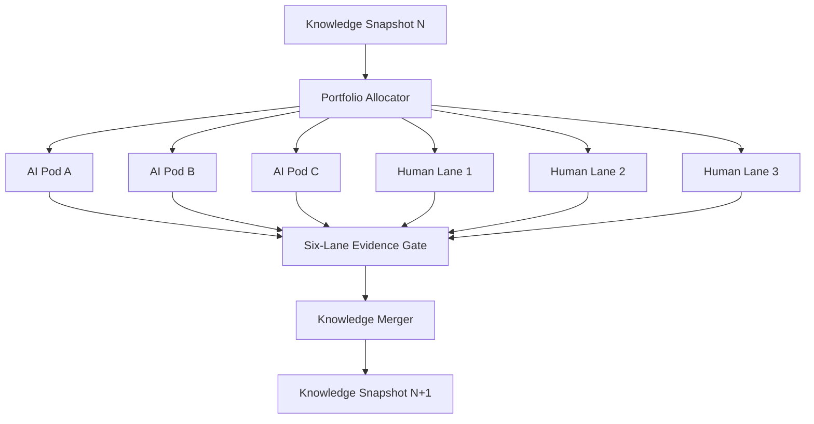

<div align="center">
  <h1>SwarmFold</h1>
  <p><strong>Distributed multi-agent experimentation for data science competitions</strong></p>

  <p align="center">
    
    
    
    
  </p>

  <p align="center">
    SwarmFold coordinates three independent end-to-end AI swarms and three human competitors. Every iteration produces six evidence packages, merges their verified findings, and distributes a new knowledge snapshot for the next search cycle.
  </p>
</div>

## Current Status

SwarmFold has completed the Phase 5 first-release implementation. Three authenticated pods and three human lanes publish one of three verified terminal packet types: candidate, failure, or waiver. A six-lane barrier feeds an admin-only submission gate, leaderboard intake, and deterministic knowledge merger. Each completed iteration produces an immutable, hash-verified snapshot that can be assigned to the next iteration. Hardening includes hash-chained access auditing, an auditor-only role, resource metering, record migrations, verified backup restore drills, retention, and evidence-derived swarm-effectiveness reports. The coordinator supports SQLite for local verification and PostgreSQL plus shared MLflow through Docker Compose.

## Development Quickstart

```bash
uv sync --extra dev
uv run swarmfold run-demo
uv run pytest
```

The demo executes the local pod from contract inspection through portfolio search, result criticism, evidence verification, and atomic publication. Candidate packets include a fixture submission file plus the complete experiment ledger and findings; failure packets never fabricate a submission. Mock planning does not require an API key.

## Docker dashboard

The coordinator serves a local-first experiment dashboard at `http://localhost:8000`.
Upload the complete competition bundle rather than selecting a target manually. File
names are not prescribed: the configured LLM profiles each file from its format,
schema, bounded samples, and the uploaded Markdown brief. The dashboard presents the
inferred task, file roles, target, metric, validation plan, submission shape,
ambiguities, and confidence for human confirmation. Training cannot start until the
confirmed profile has no blockers or unanswered questions.

Every accepted bundle run publishes a downloadable `end-to-end.ipynb`. It reconstructs
the confirmed inputs, data-quality checks, leakage-safe split, selected experiment,
held-out evaluation, full-data refit, template-preserving submission, saved model, and
reproduction metadata. The generated notebook is intentionally marked unexecuted;
recorded metrics remain traceable to the verified run evidence until the notebook is
rerun in its target environment.

The intake profiler understands arbitrary competition layouts and records unsupported
formats without pretending they can run. The built-in execution adapter supports CSV
binary classification with mixed numeric and categorical features, string or numeric
class labels, and accuracy or ROC-AUC evaluation. It requires one training source, one
inference source, and one submission template. Unknown categories are handled inside a
fold-safe preprocessing pipeline. Other task profiles stop at the confirmation gate and
identify the adapter that is still required. Each blocker and question needs a recorded
human resolution before confirmation. The browser never receives the provider API key
and keeps the coordinator token in session storage only for the lifetime of the current
tab.

Configure `.env`, then start the dashboard, PostgreSQL, and MLflow:

```bash
docker compose up --build -d
```

Open `http://localhost:8000`, then sign in with the value of
`SWARMFOLD_COORDINATOR_TOKEN` from `.env`. For a model gateway running on the Docker
host, set `SWARMFOLD_DOCKER_OPENAI_BASE_URL`; Docker Desktop normally uses
`http://host.docker.internal:20129/v1`. Dashboard experiment artifacts persist in the
shared Docker volume.

Bound the local search by run count and training time:

```bash
uv run swarmfold run-demo --max-experiments 4 --max-training-seconds 120
```

Give a run a stable thread ID so an interrupted process can continue from its durable SQLite checkpoint:

```bash
uv run swarmfold run-demo --thread-id local-pod-1
uv run swarmfold run-demo --thread-id local-pod-1 --resume
```

Every published packet is schema-checked and hash-verified before it becomes visible. It can also be validated independently later:

```bash
uv run swarmfold validate-packet .swarmfold/packets/<run-id>/candidate-packet
```

To use an OpenAI-backed planner, install the provider integration, configure the model and API key outside Git, and select live mode:

```bash
uv sync --extra dev --extra openai
export SWARMFOLD_MODEL=openai:replace-with-model-name
export OPENAI_API_KEY=replace-locally
uv run swarmfold run-demo --planner live
```

On PowerShell, use `$env:NAME = "value"` instead of `export`. Anthropic and Gemini integrations are available through the `anthropic` and `gemini` extras.

## Core Idea

Each of three laptops runs a complete autonomous data science pod that attempts to produce one candidate:

```text
problem formulation -> leakage-safe validation -> data and literature research
-> feature and model portfolio -> deterministic experiments -> ensemble assessment
-> robustness evidence -> verification -> submission candidate
```

Three team members independently produce three additional human-led candidates. The six lanes synchronize only after the iteration ends, preserving search diversity while allowing every verified success and failure to improve the next iteration.

## System Shape



## Design Priorities

- Each laptop attempts the entire competition workflow and publishes one verified terminal lane packet. Successful runs contain a candidate; failed or waived runs preserve their evidence without fabricating one.
- AI outputs are proposals until deterministic tools verify them.
- All lanes share the same data, metric, and validation contracts.
- Search charters keep the six lanes meaningfully different.
- Local validation remains the primary selection evidence.
- Failed experiments remain searchable so later agents do not repeat them.
- Submission upload remains behind a human gate and competition-rule check.

## Documentation

- [Complete project specification](PROJECT_SPEC.md)
- [MIT License](LICENSE)

## Technology

The team MVP uses Python, FastAPI, SQLAlchemy, PostgreSQL, LangChain model integrations, LangGraph with laptop-local SQLite checkpoints, Pydantic schemas, scikit-learn, and shared MLflow. Packet archives contain relative, hash-addressed artifacts so the coordinator can verify them without access to the originating laptop.

Each pod also has a literature research agent between EDA and model scouting. When
`SWARMFOLD_LITERATURE_RESEARCH=true`, it searches OpenAlex and Crossref for journal
metadata related to the confirmed competition brief and feature schema. The resulting
`literature-review.json` is included in the terminal packet and generated notebook.
Literature is treated as hypothesis support only; local validation remains required before
any method is promoted. OpenAlex works without a key at its basic allowance, while
`OPENALEX_API_KEY` and `CROSSREF_MAILTO` enable the providers' preferred access modes.

## Three-laptop coordinator

Create `.env` from `.env.example` and replace every coordinator, pod, database, and provider placeholder with independently generated secrets. The coordinator expects one admin token and a JSON mapping containing exactly three pod tokens. Each laptop receives only its own value as `SWARMFOLD_POD_TOKEN`.

Start PostgreSQL, the coordinator API, and MLflow on the coordinator machine:

```bash
docker compose up -d postgres coordinator mlflow
```

Freeze the shared contracts and create the iteration:

```bash
uv run swarmfold freeze-contracts --output-dir .swarmfold/contract-source
uv run swarmfold create-iteration \
  --coordinator-url http://coordinator-host:8000 \
  --iteration-id iteration-1 \
  --contracts .swarmfold/contract-source/contracts/bundle.json \
  --charters config/lane-charters.example.json
```

On each laptop, register the pod and fetch the immutable iteration. Replace the pod and lane IDs with `pod-b`/`ai-b` or `pod-c`/`ai-c` as appropriate:

```bash
uv run swarmfold register-pod \
  --coordinator-url http://coordinator-host:8000 \
  --pod-id pod-a --iteration-id iteration-1 --lane-id ai-a
uv run swarmfold fetch-iteration \
  --coordinator-url http://coordinator-host:8000 \
  --iteration-id iteration-1
uv run swarmfold run-demo \
  --contracts-file .swarmfold/shared-iteration.json \
  --iteration-id iteration-1 --lane-id ai-a --thread-id iteration-1-pod-a \
  --tracking-uri http://coordinator-host:5000
```

Queue the resulting packet before attempting network publication. A failed upload remains in the outbox and can be retried safely:

```bash
uv run swarmfold queue-packet PATH_TO_PACKET \
  --iteration-id iteration-1 --lane-id ai-a
uv run swarmfold flush-outbox --coordinator-url http://coordinator-host:8000
```

## Human lanes and knowledge loop

Each human prepares a metadata JSON document plus the artifacts required by the selected packet type. Candidate packets require `submission.csv`, OOF predictions, test predictions, an experiment ledger, and findings. Failure packets require the ledger and findings. Waivers require only the metadata decision and frozen contracts.

```bash
uv run swarmfold publish-human-packet \
  --metadata human-1.json \
  --contracts .swarmfold/contract-source/contracts/bundle.json \
  --submission submission.csv \
  --oof-predictions oof_predictions.parquet \
  --test-predictions test_predictions.parquet \
  --experiment-ledger experiment-ledger.jsonl \
  --findings findings.jsonl
uv run swarmfold queue-packet PATH_TO_HUMAN_PACKET \
  --iteration-id iteration-1 --lane-id human-1 \
  --outbox-dir .swarmfold/human-outbox
uv run swarmfold flush-outbox \
  --coordinator-url http://coordinator-host:8000 \
  --outbox-dir .swarmfold/human-outbox --admin
```

After all six packets arrive, record one immutable decision for every candidate. `SUBMITTED` means a human performed the external upload; SwarmFold never receives the competition credential.

```bash
uv run swarmfold submission-gate \
  --coordinator-url http://coordinator-host:8000 --iteration-id iteration-1
uv run swarmfold decide-submission \
  --coordinator-url http://coordinator-host:8000 --iteration-id iteration-1 \
  --lane-id ai-a --decision SUBMITTED --approver team-owner \
  --reason "Best verified local candidate within quota"
uv run swarmfold record-leaderboard \
  --coordinator-url http://coordinator-host:8000 --iteration-id iteration-1 \
  --lane-id ai-a --score 0.81 --recorded-by team-owner
```

When no result is expected, close intake explicitly. Then merge all accepted, rejected, conflicting, and leaderboard-only evidence into the next version:

```bash
uv run swarmfold close-leaderboard \
  --coordinator-url http://coordinator-host:8000 --iteration-id iteration-1
uv run swarmfold merge-knowledge \
  --coordinator-url http://coordinator-host:8000 \
  --iteration-id iteration-1 --snapshot-id v001
uv run swarmfold fetch-knowledge \
  --coordinator-url http://coordinator-host:8000 --snapshot-id v001
```

Pass `--knowledge-snapshot-id v001` when creating the next iteration. The coordinator rejects an unknown snapshot and returns the accepted snapshot ID with the frozen contracts and charters.

For a local SQLite coordinator, metadata and uploaded artifacts can be backed up and restored together:

```bash
uv run swarmfold backup-coordinator \
  --database .swarmfold/coordinator.db \
  --artifacts .swarmfold/coordinator-artifacts \
  --output backups/coordinator.tar.gz
uv run swarmfold restore-coordinator \
  --backup backups/coordinator.tar.gz \
  --database restored/coordinator.db \
  --artifacts restored/artifacts
```

The Compose `postgres-backup` profile provides the PostgreSQL dump path for the shared deployment. Uploaded artifacts live in the separate `shared-artifacts` volume and must be included in the coordinator machine's volume backup policy.

## Operational hardening

Configure `SWARMFOLD_AUDITOR_TOKEN` separately from the coordinator token. The auditor can read access and effectiveness reports but cannot read iterations, publish packets, approve submissions, or mutate coordinator state. Audit events contain request identity, role, route, outcome, and status only; bearer tokens and request bodies are excluded. The event chain is serialized through a locked database head and can be verified through:

```bash
uv run swarmfold audit-log --coordinator-url http://coordinator-host:8000
```

Local backups now contain a file-hash manifest and must pass SQLite integrity verification before restore. Retention only removes archives that exceed both the count and age policies:

```bash
uv run swarmfold verify-backup backups/coordinator.tar.gz
uv run swarmfold prune-backups backups --keep-last 7 --max-age-days 30
```

The Compose backup profile writes timestamped PostgreSQL dumps and applies the configured retention period. The drill profile validates the newest dump without touching the live database:

```bash
docker compose --profile backup run --rm postgres-backup
docker compose --profile drill run --rm postgres-restore-drill
```

Packet, completion, knowledge-snapshot, and prompt records have explicit migration paths from schema `0.1` to `0.2`. Migrations never overwrite their source:

```bash
uv run swarmfold migrate-record legacy-manifest.json \
  --record-type packet_manifest --output migrated-manifest.json
```

After publishing a knowledge snapshot, generate the effectiveness report from verified packets and snapshot evidence:

```bash
uv run swarmfold evaluate-effectiveness \
  --coordinator-url http://coordinator-host:8000 --iteration-id iteration-1
```

Metrics that lack evidence, such as human resolution time or a matched non-swarm control, remain explicitly unavailable rather than receiving estimated values.
